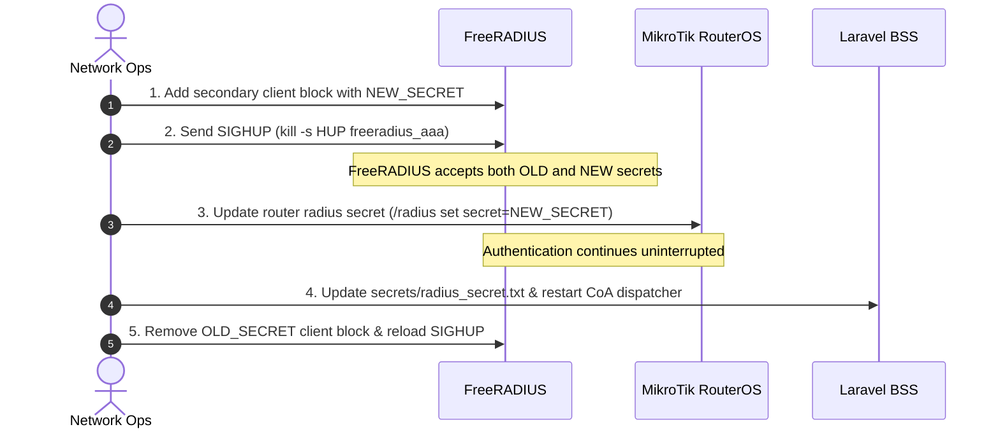

# Zero-Downtime Secrets & Credentials Rotation Runbook

**System:** Carrier-Grade ISP Billing & FreeRADIUS BSS/OSS Stack  
**Target Environment:** Docker Compose / On-Prem Ubuntu 24.04 LTS / Cloud VM  
**Last Updated:** Phase 1 Security Hardening

---

## 1. Secrets Architecture Overview

This platform decouples sensitive credentials from application code and Docker image definitions using a two-tier mechanism:
1. **Docker Secrets (`/run/secrets/`)**: Injected into containers at runtime as read-only files mounted in memory (tmpfs).
2. **Environment Variable Injection (`.env`)**: Used as fallback for local CLI operations, integration test benches, and shell scripts.

### Secrets Directory & Permissions

All local secret files are stored inside `secrets/` and `infra/secrets/` with strict POSIX permissions:
```bash
# Directory permissions: owner-only (rwx------ / 700)
chmod 700 secrets/ infra/secrets/

# Secret file permissions: owner-only read/write (rw------- / 600)
chmod 600 secrets/*.txt infra/secrets/*.txt
```

Secret files tracked by this runbook:
- `db_password.txt` — Citus coordinator and worker database password
- `redis_password.txt` — Redis 7 `requirepass` authentication token
- `radius_secret.txt` — RFC 2865 / RFC 5176 FreeRADIUS & MikroTik NAS shared secret
- `rabbitmq_password.txt` — RabbitMQ AMQP message broker password
- `bkash_secret.txt` — bKash merchant webhook HMAC-SHA256 signing secret
- `nagad_secret.txt` — Nagad merchant webhook HMAC-SHA256 signing secret
- `gemini_api_key.txt` — Google Gemini NOC Diagnostic Copilot API key

To generate or synchronize secret files, execute:
```bash
# Linux / WSL2
./scripts/generate_docker_secrets.sh

# Windows PowerShell
powershell -ExecutionPolicy Bypass -File scripts/generate_docker_secrets.ps1
```

---

## 2. Zero-Downtime Rotation Procedures

---

### Procedure 1: FreeRADIUS Shared Secret Rotation (`radius_secret`)

The FreeRADIUS shared secret authenticates RADIUS packets (`Access-Request`, `Accounting-Request`) and RFC 5176 CoA/PoD (`Disconnect-Request`) between the BNG/NAS (MikroTik) and FreeRADIUS.



#### Step-by-Step Execution:
1. **Define Dual-Secret Window in FreeRADIUS**:
   Edit `infra/freeradius/clients.conf` to declare both the current and new secret:
   ```ini
   client mikrotik_bras_primary {
       ipaddr = 10.10.0.1
       secret = "OLD_SECRET"
       nas_type = mikrotik
   }
   client mikrotik_bras_secondary {
       ipaddr = 10.10.0.1
       secret = "NEW_RANDOM_SECRET_32_CHARS"
       nas_type = mikrotik
   }
   ```
   *If using database-backed NAS (`nas` table in PostgreSQL), insert a secondary NAS entry with a unique shortname or update the record.*

2. **Reload FreeRADIUS without Dropping Traffic**:
   Send a `SIGHUP` signal to the running FreeRADIUS container:
   ```bash
   docker kill -s HUP freeradius_aaa
   ```
   Verify logs show: `Ready to process requests.`

3. **Update MikroTik RouterOS Configuration**:
   Log into the MikroTik CCR/CHR CLI:
   ```routeros
   /radius set [find service=ppp] secret="NEW_RANDOM_SECRET_32_CHARS"
   /radius incoming set secret="NEW_RANDOM_SECRET_32_CHARS"
   ```

4. **Update BSS CoA Dispatcher & Secrets File**:
   Update `secrets/radius_secret.txt` and `infra/secrets/radius_secret.txt`:
   ```bash
   printf "NEW_RANDOM_SECRET_32_CHARS" > secrets/radius_secret.txt
   printf "NEW_RANDOM_SECRET_32_CHARS" > infra/secrets/radius_secret.txt
   ```
   Restart the Laravel BSS container:
   ```bash
   docker restart laravel_bss_oss
   ```

5. **Remove Old Secret**:
   Remove the old client entry from `clients.conf` and issue `docker kill -s HUP freeradius_aaa`.

---

### Procedure 2: Citus / PostgreSQL Password Rotation (`db_password`)

To rotate the PostgreSQL database password without terminating existing database pools:

1. **Update User Password in Citus**:
   Connect to `citus_master`:
   ```bash
   docker exec -it citus_master psql -U isp_admin -d isp_bss_oss -c "ALTER USER isp_admin WITH PASSWORD 'NEW_STRONG_DB_PASS_2026!';"
   ```

2. **Update `.pgpass` on Citus Master & Worker Nodes**:
   Update the connection password used by the coordinator to talk to workers:
   ```bash
   docker exec citus_master sh -c "echo '*:*:*:isp_admin:NEW_STRONG_DB_PASS_2026!' > /root/.pgpass && chmod 600 /root/.pgpass"
   docker exec citus_worker_1 sh -c "echo '*:*:*:isp_admin:NEW_STRONG_DB_PASS_2026!' > /root/.pgpass && chmod 600 /root/.pgpass"
   docker exec citus_worker_2 sh -c "echo '*:*:*:isp_admin:NEW_STRONG_DB_PASS_2026!' > /root/.pgpass && chmod 600 /root/.pgpass"
   ```

3. **Update Secret Files**:
   ```bash
   printf "NEW_STRONG_DB_PASS_2026!" > secrets/db_password.txt
   printf "NEW_STRONG_DB_PASS_2026!" > infra/secrets/db_password.txt
   ```

4. **Graceful Restart of Dependent Services**:
   Restart the FreeRADIUS and Laravel containers to re-establish connection pools:
   ```bash
   docker restart freeradius_aaa laravel_bss_oss
   ```

---

### Procedure 3: Redis Auth Token Rotation (`redis_password`)

Redis 7 supports dynamic runtime authentication rotation without restarting the server:

1. **Apply New Password via `redis-cli`**:
   Connect to `redis_cluster` and execute `CONFIG SET requirepass`:
   ```bash
   docker exec redis_cluster redis-cli -a "$CURRENT_REDIS_PASSWORD" CONFIG SET requirepass "NEW_REDIS_TOKEN_2026!"
   docker exec redis_cluster redis-cli -a "NEW_REDIS_TOKEN_2026!" CONFIG REWRITE
   ```

2. **Update Secret Files**:
   ```bash
   printf "NEW_REDIS_TOKEN_2026!" > secrets/redis_password.txt
   printf "NEW_REDIS_TOKEN_2026!" > infra/secrets/redis_password.txt
   ```

3. **Reload Laravel Application**:
   Update `infra/.env` with `REDIS_PASSWORD=NEW_REDIS_TOKEN_2026!` and restart `laravel_bss_oss`:
   ```bash
   docker restart laravel_bss_oss
   ```

---

### Procedure 4: bKash / Nagad Webhook Signing Secret Rotation (`bkash_secret`, `nagad_secret`)

MFS webhooks verify payment settlement notifications using HMAC-SHA256 signatures. To rotate the secret:

1. **Generate New Secret in MFS Portal**:
   Generate a new App Secret / Merchant Key in the bKash / Nagad Developer Console.

2. **Stage the New Secret in Secret Files**:
   ```bash
   printf "NEW_BKASH_APP_SECRET_2026" > secrets/bkash_secret.txt
   printf "NEW_BKASH_APP_SECRET_2026" > infra/secrets/bkash_secret.txt
   ```

3. **Activate Secret in Laravel**:
   The `MfsWebhookController` reads `/run/secrets/bkash_secret` at runtime. Restart the application container to remount:
   ```bash
   docker restart laravel_bss_oss
   ```

4. **Verify Settlement Pipeline**:
   Run the end-to-end integration test to verify the new signature matches:
   ```bash
   python scripts/test_e2e_mfs_settlement.py
   ```

---

### Procedure 5: RabbitMQ Broker Password Rotation (`rabbitmq_password`)

1. **Change Password via CLI**:
   ```bash
   docker exec rabbitmq_broker rabbitmqctl change_password isp_rabbit "NEW_RABBITMQ_PASS_2026!"
   ```

2. **Update Secret Files**:
   ```bash
   printf "NEW_RABBITMQ_PASS_2026!" > secrets/rabbitmq_password.txt
   printf "NEW_RABBITMQ_PASS_2026!" > infra/secrets/rabbitmq_password.txt
   ```

3. **Restart Application Consumers**:
   ```bash
   docker restart laravel_bss_oss
   ```

---

## 3. Emergency Credential Revocation Protocol

If a secret is inadvertently committed to version control or compromised:

1. **Immediate Revocation**:
   - For **Google Gemini API Key**: Immediately open the [Google AI Studio API Keys Page](https://aistudio.google.com/app/apikey) or Google Cloud Console, click **Delete Key**, and generate a replacement.
   - For **bKash / Nagad Keys**: Immediately notify the respective MFS partner representative to invalidate the webhook client key.
2. **Execute Full Secret Regeneration**:
   ```bash
   # Remove compromised secret files
   rm -f secrets/*.txt infra/secrets/*.txt
   
   # Re-generate all secrets with cryptographically random 256-bit entropy
   ./scripts/generate_docker_secrets.sh
   ```
3. **Rebuild & Restart Stack**:
   ```bash
   docker compose -f infra/docker-compose.yml up -d --force-recreate
   ```
4. **Run Audit Verification**:
   ```bash
   python scripts/test_e2e_mfs_settlement.py
   docker exec laravel_bss_oss sh -c "cd /opt/laravel_bss && vendor/bin/phpunit"
   ```
