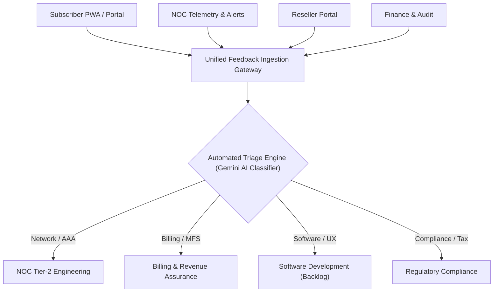

# Carrier Feedback Triage & Continuous Improvement Process

**Project:** ISP Billing Service & FreeRADIUS Automation (Carrier Scale 1M–10M)  
**Lead Architect & Owner:** Tapos (N M Hedyetullah Tapos)  
**Document Status:** Approved Operational Standard  
**Baseline Reference:** [docs/BASELINE_AND_RULES.md](../BASELINE_AND_RULES.md) (Stage 12 / 13 Evolution)

---

## 1. Objective & Scope

Day-2 carrier operations require a structured, automated mechanism to ingest, categorize, triage, and resolve feedback from four distinct stakeholder groups:
1. **End Subscribers (Retail / Corporate):** Self-Care PWA bug reports, bill dispute requests, and payment inquiries.
2. **NOC & Operations Engineers:** RADIUS session anomalies, CoA failures, MikroTik sync discrepancies, and GenieACS telemetry warnings.
3. **Reseller & POP Partners:** Multi-tenant billing limits, commission calculation questions, and bulk provisioning issues.
4. **Finance & Audit Teams:** Mushak-6.3 VAT reports, general ledger balancing, and MFS reconciliation variance.

---

## 2. Ingestion Channels & Classification

---

## 3. Triage Priority & Resolution SLAs

| Priority | Category / Criteria | Triage SLA | First Response | Resolution SLA |
| :---: | :--- | :---: | :---: | :---: |
| **P1** | Widespread payment unblock failures, mass PPPoE drops, billing debit errors | < 10 mins | < 15 mins | < 2 hours |
| **P2** | Individual subscriber unblock delay, single NAS CoA kick failure, reseller login stall | < 30 mins | < 1 hour | < 6 hours |
| **P3** | Incorrect invoice PDF layout, slow report generation (>10s), optical alert noise | < 4 hours | < 8 hours | Next Sprint |
| **P4** | Minor typo, enhancement suggestion, non-critical dashboard styling | < 24 hours | < 48 hours | Backlog Grooming |

---

## 4. Bi-Weekly Triage Council (Evolution Loop)

Every alternating Tuesday, the Lead Architect (Tapos), NOC Lead, and Product Team convene for the **Evolution Review**:
1. **Trend Analysis:** Review top 5 recurring friction points reported in the last 14 days.
2. **Defect-to-Debt Conversion:** If a recurring issue requires architectural remediation, create a `TD-xxx` ticket in `docs/11-evolution/TECHNICAL_DEBT.md`.
3. **Release 2.0 Backlog Prioritization:** Adjust feature sequencing in `docs/11-evolution/PRODUCT_ROADMAP.md` based on operator demand.
4. **Sign-off:** Approvals documented in sprint backlog.
