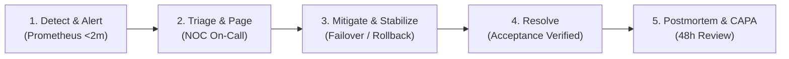

# Incident Postmortem Runbook & Operational Learning Framework

**Project:** ISP Billing Service & FreeRADIUS Automation (Carrier Scale 1M–10M)  
**Lead Architect & Owner:** Tapos (N M Hedyetullah Tapos)  
**Document Status:** Approved Operational Standard  
**Baseline Reference:** [docs/BASELINE_AND_RULES.md](../BASELINE_AND_RULES.md) (Stage 12 / 13 Evolution)

---

## 1. Principles of Blameless Postmortems

In high-concurrency carrier operations (1M–10M subscribers), incidents are treated as invaluable learning opportunities rather than occasions to assign human blame.

1. **Systemic over Individual:** Human errors are symptoms of systemic shortcomings in tooling, automation, validation, or architectural safeguards.
2. **Honesty & Transparency:** Teams must feel psychologically safe to describe exact timelines, command executions, and configuration oversights.
3. **Action-Oriented:** Every postmortem must yield concrete, trackable Corrective and Preventative Actions (CAPA) with assigned owners and hard deadlines.
4. **Knowledge Sharing:** Postmortems are shared across NOC engineering, BSS software developers, and executive leadership.

---

## 2. Severity Classification & Postmortem Trigger Matrix

| Severity | Definition | MTTD Target | MTTR Target | Postmortem Requirement |
| :---: | :--- | :---: | :---: | :---: |
| **P1 - Critical** | AAA down, >5% subscribers unable to authenticate, Keepalived VIP failure, DB data corruption. | < 2 min | < 15 min | **Mandatory** (Within 48h) |
| **P2 - High** | MFS payment webhook delays (>30s), CoA queue backlog (>5,000 requests), single worker crash. | < 5 min | < 30 min | **Mandatory** (Within 72h) |
| **P3 - Medium** | Customer PWA latency, reporting/export slowdown, single TR-069 poll timeout. | < 15 min | < 2 hours | Review at Sprint Retrospective |
| **P4 - Low** | Minor UI visual defect, non-blocking admin log warning. | < 1 day | < 3 days | Standard Bug Ticket |

---

## 3. Incident Lifecycle Phases

### Phase 1: Detection & Alerting
- Prometheus Alertmanager fires alert based on rule triggers (`RadiusAuthLatencyHigh`, `KeepalivedVipLost`, `PostgreSqlWorkerDown`).
- NOC On-Call engineer acknowledges alert within 3 minutes.

### Phase 2: Containment & Mitigation
- Immediate priority is restoring carrier traffic, **NOT** debugging root cause in production.
- If Citus master stalls: Trigger pgBackRest standby promote.
- If primary FreeRADIUS node fails: Keepalived automatically swings VIP `10.10.0.10` to Node 2 (<1 second).
- If bad release deployed: Execute 5-minute rollback runbook (`STAGE_12_CUTOVER_RUNBOOK.md`).

### Phase 3: Root Cause Analysis (5 Whys)
- Convene postmortem meeting with NOC lead, DevOps architect, and BSS developers within 24 hours of incident closure.
- Apply 5-Whys analysis until structural, software, or process root causes are exposed.

### Phase 4: Action Item Assignment & Verification
- Enter all corrective actions into the Sprint backlog.
- P1 corrective actions must be deployed within 14 business days.

---

## 4. Postmortem Review Checklist

- [ ] Clear chronological timeline established with millisecond-precision timestamps.
- [ ] Root cause identified down to the protocol, SQL query, code commit, or network event.
- [ ] Impact accurately quantified (number of dropped PPPoE sessions, revenue impact, duration).
- [ ] "Where we got lucky" section completed (analyzing near-misses).
- [ ] Minimum 2 preventative action items defined with assigned owners and issue links.
- [ ] Lead Architect (Tapos) sign-off recorded.
