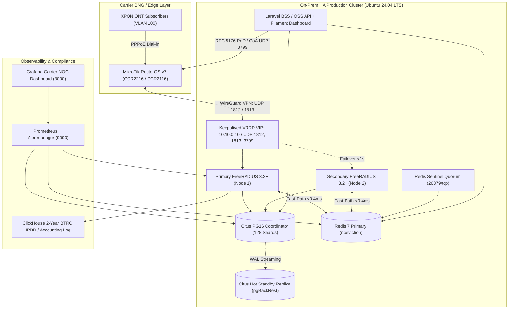

# Stage 12: Zero-Downtime Production Cutover & Rollback Runbook

**Project:** ISP Billing Service & FreeRADIUS Automation (Carrier Scale 1M–10M)  
**Lead Architect & Owner:** Tapos (N M Hedyetullah Tapos)  
**Target Environment:** Ubuntu 24.04 LTS On-Premises / Dedicated Servers + MikroTik RouterOS v7 BNG/CCR  
**Date:** 20 November 2026 | **Version:** 1.0.0  
**Baseline & Base Rule:** [docs/BASELINE_AND_RULES.md](BASELINE_AND_RULES.md)  

---

## 1. High-Level Cutover Architecture & Trust Boundaries



---

## 2. Pre-Cutover Verification & Readiness Checklist

### A. T-72 Hours: Infrastructure & Security Audit
- [ ] **Zero Hardcoded Secrets:** Confirm `/infra/.env` and production `.env` are excluded from Git (`.gitignore`).
- [ ] **Dual-Node Keepalived VIP (`10.10.0.10`):**
  - Verify Keepalived configuration on Node 1 (Master, priority 101) and Node 2 (Backup, priority 100).
  - Test failover: `sudo systemctl stop freeradius` on Node 1 -> VIP transfers to Node 2 within `<1 second`.
- [ ] **Redis Policy Verification:**
  - Execute `redis-cli config get maxmemory-policy` on all nodes -> Confirm output is strictly `noeviction`.
- [ ] **pgBackRest Differential Backup Drill:**
  - Execute `bash infra/ha/pgbackrest_backup_restore_drill.sh`.
  - Confirm delta restore into `/tmp/pg_restore_drill` completes with zero checksum mismatches.

### B. T-24 Hours: MikroTik Sandbox & WireGuard Tunnel Validation
- [ ] **WireGuard Peering (`10.10.0.0/24`):**
  - Ping test: Ubuntu Server (`10.10.0.1`) <-> MikroTik BNG (`10.10.0.2`) latency `< 1.0ms`.
- [ ] **MikroTik CoA Listening Port:**
  - On MikroTik: `/radius incoming print` -> `accept: yes`, `port: 3799`.
- [ ] **Walled Garden NAT Validation:**
  - Verify NAT rule redirects port `80/tcp` from `10.250.0.0/24` to Captive Bill-Pay Portal.
- [ ] **Single-Subscriber Isolated Pilot (`tapos_pilot`):**
  - **MikroTik RouterOS v7 Setup (Paste into MikroTik CLI):**
    ```routeros
    # 1. Allow UDP 3799 CoA/Disconnect in Firewall Input Filter (Ensures CoA packets are not dropped)
    /ip firewall filter
    add chain=input action=accept protocol=udp dst-port=3799 src-address=<UBUNTU_IP> \
        comment="PILOT_TAPOS_TEST: Allow RFC 5176 CoA/PoD Disconnect from Ubuntu RADIUS" place-before=1

    # 2. Enable Incoming RFC 3576 / RFC 5176 CoA Listener
    /radius incoming
    set accept=yes port=3799

    # 3. Add FreeRADIUS 3.x Client
    /radius
    add address=<UBUNTU_IP> service=ppp authentication-port=1812 accounting-port=1813 \
        timeout=3000ms secret="<RADIUS_SECRET>" comment="PILOT_TAPOS_TEST: Ubuntu 24.04 FreeRADIUS"

    # 4. Enable PPP AAA with 5-Minute Interim Accounting
    /ppp aaa
    set accounting=yes interim-update=5m use-radius=yes
    ```
  - **Pilot Verification Workflow:**
    ```bash
    # Print dynamically populated RouterOS v7 CLI commands:
    ./scripts/run_single_sub_pilot.sh -s <UBUNTU_IP> -m <MIKROTIK_IP> -r <RADIUS_SECRET> --print-ros

    # Dry-run pre-flight validation (safe, zero DB writes):
    ./scripts/run_single_sub_pilot.sh -s <UBUNTU_IP> -u ubuntu -i ~/.ssh/id_rsa -m <MIKROTIK_IP> -r <RADIUS_SECRET> --dry-run

    # Full automated pilot run (with 5-minute observation window and zero-stray rollback):
    ./scripts/run_single_sub_pilot.sh -s <UBUNTU_IP> -u ubuntu -i ~/.ssh/id_rsa -m <MIKROTIK_IP> -r <RADIUS_SECRET>

    # Force instant idempotent cleanup / teardown:
    ./scripts/run_single_sub_pilot.sh -s <UBUNTU_IP> -u ubuntu -i ~/.ssh/id_rsa --cleanup
    ```

### C. T-2 Hours: Freeze Window & Team Briefing
- [ ] Change freeze announced to NOC, Support, and Reseller partners.
- [ ] Team roles assigned:
  - **Lead Architect / Approver:** Tapos
  - **Primary Systems Engineer:** Executing Citus & FreeRADIUS commands
  - **Network / BRAS Engineer:** Executing MikroTik RouterOS updates
  - **QA / Validation Lead:** Monitoring MFS and subscriber reconnect latency

---

## 3. Maintenance Window Execution (03:00 AM – 04:30 AM Asia/Dhaka)

### Phase 1: Database LSN & Cache Synchronization (03:00 – 03:15 AM)
1. **Lock legacy subscriber write-plane:**
   ```bash
   # Enable maintenance mode on legacy billing system
   touch /var/www/html/storage/framework/down
   ```
2. **Perform final incremental data export / replication sync:**
   ```bash
   # Verify Citus coordinator replication lag
   docker exec -it citus_master psql -U isp_admin -d isp_bss_oss -c \
     "SELECT client_addr, state, sync_state, replay_lag FROM pg_stat_replication;"
   ```
3. **Warm Redis 7 Fast-Path Cache:**
   ```bash
   # Pre-populate active subscriber auth hashes into Redis Fast-Path
   docker exec -it laravel_bss_oss php /opt/laravel_bss/artisan radius:warm-cache --tenant=all
   ```

---

### Phase 2: FreeRADIUS Dual-Node VIP Activation (03:15 – 03:30 AM)
1. **Start Primary & Secondary FreeRADIUS daemons:**
   ```bash
   # Node 1 & Node 2
   docker compose -f infra/docker-compose.yml up -d freeradius
   ```
2. **Verify Keepalived VIP binding:**
   ```bash
   ip addr show eth0 | grep 10.10.0.10
   ```
3. **Execute local AAA verification probe:**
   ```bash
   radtest tapos_test Tapos@2026 10.10.0.10 0 ${RADIUS_SECRET}
   # EXPECT: Received Access-Accept in <10ms
   ```

---

### Phase 3: MikroTik BRAS / CCR Live Switchover (03:30 – 03:50 AM)
1. **Add new FreeRADIUS Cluster to MikroTik CCR:**
   ```routeros
   /radius
   add address=10.10.0.10 secret="${RADIUS_SECRET}" service=ppp timeout=3000ms authentication-port=1812 accounting-port=1813 comment="NEW_HA_FREERADIUS_VIP"
   ```
2. **Switch active PPP authentication order:**
   ```routeros
   # Move new RADIUS server to index 0 (top priority)
   /radius move [find comment="NEW_HA_FREERADIUS_VIP"] 0
   ```
3. **Verify live PPPoE session dial-ins:**
   ```routeros
   /interface pppoe-server print count-only
   /log print where message~"radius"
   ```
4. **Trigger test RFC 5176 Disconnect (PoD) on Canary VLAN 999 ONT:**
   ```bash
   # From Ubuntu BSS Server
   printf 'User-Name = "canary_test"\n' | radclient -r 2 -t 1 10.10.0.2:3799 disconnect ${RADIUS_SECRET}
   # EXPECT: Received Disconnect-ACK within <500ms
   ```

---

### Phase 4: Fintech & End-to-End SLA Validation (03:50 – 04:15 AM)
1. **Send Mock MFS Webhook Payment:**
   ```bash
   curl -s -X POST http://127.0.0.1:8000/api/v1/webhooks/bkash \
     -H "Content-Type: application/json" \
     -H "X-MFS-Signature: <valid_hmac>" \
     -d '{"trx_id":"TRX_CUTOVER_01","subscriber_id":"11111111-1111-1111-1111-111111111111","invoice_id":"22222222-2222-2222-2222-222222222222","amount_bdt":1000}'
   ```
2. **Verify SLA targets:**
   - [ ] Webhook acknowledged with `HTTP 202` in `<80ms`.
   - [ ] Redis `SETNX` idempotency lock verified (`mfs:tx:bkash:TRX_CUTOVER_01`).
   - [ ] Subscriber unblock PoD packet arrived at MikroTik within `<3.0s`.
   - [ ] Subscriber bandwidth restored from `128k/128k` to `20M/20M`.

---

### Phase 5: Production Go-Live Sign-Off (04:15 – 04:30 AM)
1. **Disable legacy RADIUS entry on MikroTik:**
   ```routeros
   /radius set [find comment="LEGACY_RADIUS"] disabled=yes
   ```
2. **Verify Prometheus & Grafana telemetry:**
   - Prometheus `http://localhost:9090/targets` -> `postgresql`, `redis`, `freeradius` all `UP`.
   - Grafana `http://localhost:3000/d/isp-noc-sla-v1` displaying live session rates and zero evictions.
3. **Owner Sign-Off:** Lead Architect (Tapos) confirms maintenance window close.

---

## 4. Emergency Rollback Plan (Zero-Downtime Guarantee)

> [!CAUTION]
> **Rollback Trigger Criteria:**
> - AAA Auth error rate > 0.5% for > 3 minutes.
> - MikroTik CoA/PoD timeout rate > 2%.
> - Citus coordinator connection pool exhaustion (>180 connections).
> - Any unrecoverable database split-brain.

### 5-Minute Rollback Sequence:

1. **Re-enable Legacy RADIUS on MikroTik (Immediate, T+30s):**
   ```routeros
   /radius set [find comment="LEGACY_RADIUS"] disabled=no
   /radius move [find comment="LEGACY_RADIUS"] 0
   /radius set [find comment="NEW_HA_FREERADIUS_VIP"] disabled=yes
   ```
2. **Flush volatile PPPoE sessions on MikroTik (T+60s):**
   ```routeros
   # Soft disconnect sessions to force re-authentication against legacy RADIUS
   /interface pppoe-server remove [find user="canary_test"]
   ```
3. **Database Point-in-Time Recovery via pgBackRest (If DB corrupted, T+3m):**
   ```bash
   docker exec -it citus_master pgbackrest --stanza=isp_bss_oss --type=time "--target=2026-11-20 03:00:00" restore
   docker restart citus_master
   ```
4. **Notify NOC and Stakeholders:** Broadcast rollback completion and resume legacy operation.

---

## 5. Post-Cutover Compliance & Audit Verification

- **BTRC IPDR Logging:** Verify RADIUS `radacct` stream is actively populating and retained for 2 years per regulatory mandates.
- **NBR Mushak-6.3 Audit:** Ensure all generated invoices correctly compute 5%/15% VAT and record ISP BIN.
- **24-Hour Observation:** NOC engineer on continuous telemetry watch with Gemini AI Copilot (`/api/v1/ai/diagnose`) on standby.

